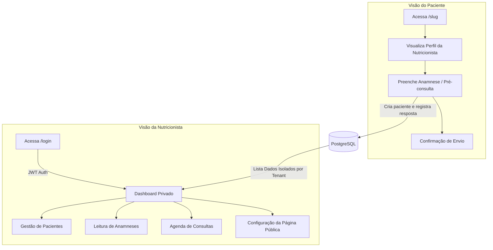

# Pull Request: NutriOpus v1.0 (MVP Foundation)

## 📌 Descrição do Projeto
O **NutriOpus** é uma plataforma SaaS voltada para nutricionistas. O objetivo principal é centralizar a captação de pacientes, agendamento de consultas e gerenciamento de anamneses (pré-consultas) em um único ambiente, garantindo isolamento total de dados (Multi-Tenant).

Nesta primeira versão (MVP), entregamos a fundação completa da plataforma, desde o banco de dados relacional até a interface de usuário construída com as melhores práticas do Next.js 16 (App Router).

---

## 🏗️ Arquitetura e Fluxo de Dados

Abaixo está o diagrama do fluxo principal da aplicação, separando a visão do Paciente e a visão da Nutricionista:

---

## ✨ Features Implementadas

### 🔒 Autenticação e Multi-Tenancy
- [x] Login seguro utilizando `bcryptjs` para senhas.
- [x] Gerenciamento de sessão com JWT (`jose`) armazenado em cookie `httpOnly`.
- [x] Helper `assertTenantAccess` protegendo todas as rotas do `/dashboard`.
- [x] Separação estrita de dados: uma nutricionista não tem acesso aos pacientes/dados de outra.

### 🌍 Página Pública (`/[tenant]`)
- [x] Página pública dinâmica baseada no `slug` da nutricionista.
- [x] Visualização de Bio, Especialidades (tags), CRN, endereço e links de contato (WhatsApp/Email).
- [x] Botão *Call-to-Action* para o preenchimento da pré-consulta.

### 📝 Formulário de Pré-Consulta (Anamnese)
- [x] Multi-step form interativo com `react-hook-form` e validação rigorosa via `zod`.
- [x] Criação automática do paciente no banco, ou atualização inteligente se o telefone já existir para aquela nutricionista.
- [x] Processamento no servidor para calcular **IMC**, avaliar riscos e extrair **Pontos de Atenção Clínicos** (ex: Obesidade, Histórico de doenças crônicas, Problemas de sono).
- [x] Resumo textual gerado automaticamente a partir das respostas.
- [x] Aceite da LGPD obrigatório.

### 📊 Dashboard e Gestão Interna
- [x] **Dashboard:** Estatísticas em tempo real (consultas da semana, novos pacientes, status de anamneses).
- [x] **Pacientes:** Listagem, cadastro manual, edição e histórico do paciente.
- [x] **Anamnese:** Leitura detalhada das respostas, sistema de status (Nova/Revisada) e página formatada via CSS para geração de PDF (`window.print()`).
- [x] **Agenda:** Navegação cronológica por semanas, agrupamento de dias, criação de agendamentos (Online/Presencial) e controle de status.
- [x] **Configuração:** Edição de perfil da Nutricionista (Bio, cores do tema, endereço, WhatsApp), refletindo instantaneamente na página pública.

### 🧪 Qualidade de Código e Testes
- [x] Suíte de testes com `vitest` instalada e configurada com `tsconfig-paths`.
- [x] **66 testes unitários** cobrindo regras de negócios cruciais: cálculo de idade, IMC, classificação da OMS, extração de pontos de atenção, gerador de resumos lógicos e schemas de validação Zod.
- [x] Reutilização estrita de componentes e compartilhamento de Types/Schemas entre Frontend (RHF) e Backend (Server Actions).

---

## 📂 Estrutura de Arquivos e Responsabilidades

| Diretório / Arquivo | Responsabilidade Principal |
|---------------------|----------------------------|
| `prisma/schema.prisma` | Define a modelagem do banco. Tabelas: `User`, `Nutritionist`, `Patient`, `AnamneseResponse`, `Appointment`. |
| `src/app/[tenant]/` | Páginas de visualização pública. Onde o paciente vê a página da nutri e envia a anamnese. |
| `src/app/dashboard/` | Ambiente restrito. Contém layout com Sidebar e páginas de Gestão (Agenda, Pacientes, Config). |
| `src/actions/` | *Server Actions* (Next.js). Funções chamadas pelos formulários do front-end para mutação de dados (POST/PUT). |
| `src/services/` | Regras de negócios isoladas. Centraliza operações complexas com o `prisma` (Banco de Dados). |
| `src/validation/` | Arquivos do Zod. Garantem que os dados obedeçam a regras rígidas de tipagem e formato antes de tocar no banco. |
| `src/lib/tenancy/` | Funções de proteção. O "guardião" que verifica a sessão JWT e impede acesso não autorizado a tenants. |
| `src/lib/utils/` | Funções puras e utilitárias fortemente testadas pelo Vitest (ex: lógica matemática e extração de texto). |
| `src/components/` | Componentes React reutilizáveis de interface. Divididos em domínios (`patients`, `appointments`, `forms`). |

---

## 🛠️ Stack Tecnológica
- **Framework Core:** Next.js 16 (App Router)
- **Linguagem:** TypeScript
- **Estilização UI:** TailwindCSS v4 + Componentes Radix UI via shadcn/ui + lucide-react
- **Gerenciamento de Forms:** React Hook Form + Zod 4
- **ORM & Banco de Dados:** Prisma ORM v6 conectando ao PostgreSQL
- **Testes Unitários:** Vitest
- **Ferramentas Utilitárias:** `bcryptjs` (hash de senhas), `jose` (sessões JWT ultraleves), `date-fns` (manipulação de datas).

---

## 🚀 Como Validar (Reviewers)
1. Instale as dependências: `npm install`.
2. Inicie o banco de dados via docker e gere o banco: `docker compose up -d postgres && npx prisma migrate dev && npm run prisma:seed`.
3. Inicie a aplicação `npm run dev`.
4. Entre no **Dashboard** via `http://localhost:3000/login` utilizando a conta semeada (`fabiola@nutriopus.com` / `123456`).
5. Entre na **Página Pública** via `http://localhost:3000/fabiola`.
6. Rode a suíte de testes usando o comando `npm run test` (todos os 66 devem passar em menos de 2s).
