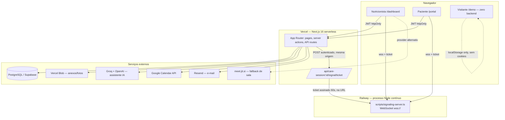
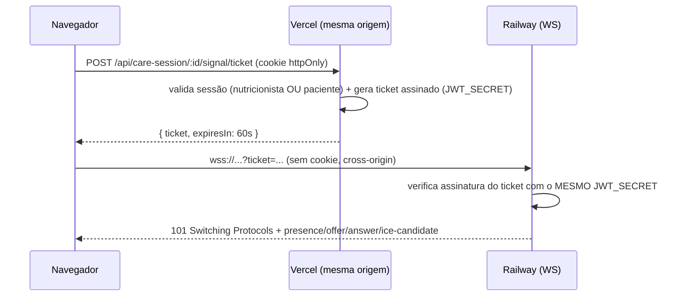

# Pull Request: NutriOpus Beta — Atendimento nativo, Oficina de Planos, Portal, IA e correções de feedback real

**Branch:** `fix/beta-version-bugs` → `dev`
**Commits:** `c069137` feat: nutriopus beta version · `c121a09` fix: beta version bugs · `9674ad3` fix: video call sessions · `410087a` fix: beta version bugs
**Diff:** 789 arquivos alterados · +88.868 / -3.429 linhas · 16 migrations novas · 38 models no schema

---

## 📌 Contexto

Esta PR consolida o ciclo **Beta** do NutriOpus: a fundação do MVP (`dev` atual) ganha atendimento por videochamada nativa (WebRTC próprio, sem depender só do Jitsi), editor de planos alimentares em canvas, portal do paciente completo, assistente de IA flutuante, modo demo público, e duas rodadas de correção sobre **feedback real de uma nutricionista usando o produto** — não são só features "no papel", vários itens aqui existem porque quebraram em uso real e foram reauditados com referências de UX/acessibilidade antes de corrigir de novo (ver `docs/BETA_FEEDBACK_REAUDIT_2026-07-05.md`).

---

## 🏗️ Arquitetura geral

### Fluxo de autenticação da videochamada nativa (o problema que exigiu mais cuidado)

O servidor WebSocket roda num host **diferente** da Vercel (Railway), então os cookies de sessão (`nutriopus-session`, `nutriopus-patient-session`) — que são *host-only* — nunca chegariam lá. A solução foi um ticket assinado de curta duração:

---

## ✨ Features implementadas

### 📹 Atendimento online / Videochamada
- Provider **nativo** (WebRTC próprio) além do Jitsi: `NativeVideoRoom`, seleção de câmera/microfone (`NativeDeviceSelector`), fila de ICE candidates para evitar corrida de sinalização, status de conexão em tempo real.
- Três transportes de sinalização intercambiáveis: **WebSocket** (produção, `scripts/signaling-server.ts`), **SSE** (`.../signal/stream`) e **polling** (fallback sem infra extra) — ver `docs/CARE_SESSION_SIGNALING_WEBSOCKET.md`, `SSE.md`.
- Autenticação por ticket assinado de curta duração (não depende de cookie cross-origin) — `docs/CARE_SESSION_SIGNALING_PRODUCTION_DEPLOY.md`.
- Registro de transcrição da consulta (`docs/TRANSCRIPTIONS.md`, `TRANSCRIPTION_PROVIDERS.md`, `TRANSCRIPTION_PRIVACY_AND_LGPD.md`).

### 🍽️ Oficina de Planos Alimentares (Studio)
- Editor em canvas com **Tiptap** (rich text) + **dnd-kit** (drag & drop) para montar refeições/planos.
- Cópia de modelo em lote (server action única em vez de cascata de POSTs por refeição/alimento).
- Ações de excluir/duplicar/aplicar a paciente com estado de loading real, confirmação por modal e feedback de erro por toast (bug corrigido nesta rodada — o dialog de confirmação existia mas a Promise nunca era resolvida).
- **Geração de PDF real** client-side: paginação A4 fiel (`PagedMealPlanSheet`, mede `offsetHeight` para não ser afetado por zoom), zoom puramente visual via `transform: scale()` (não usa CSS `zoom`, que quebrava a paginação), export via `jspdf` + `html2canvas` carregados sob demanda.
- Substituições de alimentos e equivalentes caseiros (`docs/MEAL_SUBSTITUTIONS_AND_EQUIVALENTS.md`, `HOUSEHOLD_MEASURES.md`).

### 🧑‍⚕️ Prontuário e avaliação clínica
- Prontuário 360°: timeline, notas rápidas, comparativo inicial vs. atual, tags.
- Antropometria completa + dobras cutâneas (`docs/ANTHROPOMETRY_MODULE.md`) com gráficos de evolução.
- Ficha clínica resumida imprimível, anexos/fotos de progresso (Vercel Blob).

### 🌐 Portal do paciente
- Redesenho completo: home, agenda (com histórico), cardápio, evolução, diário alimentar, lista de compras, chat com nutricionista, check-in diário de bem-estar/humor.
- Login com foto da nutricionista, redirecionamento de sessão já autenticada (bug corrigido — antes mostrava tela de login mesmo logado).
- Assistente de IA dedicado ao paciente.

### 🤖 Assistente de IA flutuante + ferramentas
- Chat flutuante com respostas via Groq/OpenAI (`ai` SDK), ações seguras de navegação (`NAVIGATE`/`OPEN_TOOL`/`OPEN_PATIENT`) inferidas do texto.
- **Respostas instantâneas** para os prompts sugeridos (bypassa a chamada de IA — `canned-responses.ts`), resolvendo a lentidão percebida nos atalhos.
- Dock de ferramentas flutuantes (calculadoras, busca TACO) com janelas arrastáveis — refatorado para não bloquear a tela em desktop (bug do overlay/blur reportado no beta).

### 📅 Agenda e integrações
- Sincronização com Google Calendar + export iCal.
- Lembretes e metas do paciente.

### 🎨 Temas, i18n e acessibilidade
- Seletor de tema com **paletas curadas** (não mais cor livre) validadas por contraste WCAG 2.2 (`docs/CURATED_THEME_PALETTES_2026-07-08.md`): Tema Claro, NutriOpus Claro, Clínico Suave, Bege Minimalista, Rosa Suave, Lilás Elegante, além do escuro.
- Tooltip acessível via portal (`AppTooltip`, WAI-ARIA APG), sino de notificações com dados reais (lembretes, consultas do dia, anamneses novas, mensagens não lidas, humor baixo).
- i18n completo PT/EN/ES com troca instantânea de idioma (`docs/I18N_INSTANT_LANGUAGE_SWITCH.md`).

### 🧪 Modo Demo público
- `/demo` — dashboard e portal navegáveis publicamente **sem login, sem banco, sem backend**, reusando os componentes reais (não é uma UI paralela) via rotas-ponte que redirecionam links gerados pelos componentes de volta para `/demo/*`.
- Zero cookie/sessão real, chamada nativa bloqueada por feature flag, badge "DEMO" sempre visível, `noindex`, estado interativo em `localStorage` com botão de reset.

### 👥 Equipe e permissões
- RBAC básico de equipe (`docs/SPRINT_...TEAM_RBAC` / model `team_rbac`).

### 📊 Dashboard operacional
- KPIs (consultas da semana, aniversários, planos ativos, engajamento, sem check-in há 7 dias), cards linkados às telas correspondentes.

---

## 🐛 Correções de bugs (feedback real de uso — 2 rodadas)

**Rodada 1** (`docs/BETA_FEEDBACK_FIXES_2026-07-04.md`):
- Carboidratos da tabela TACO podendo virar zero (faltava normalização de decimal com vírgula/aliases).
- Idade exibida literalmente como `{{count}}` (i18n só interpolava chave exata `{{age}}`).
- Portal do paciente mostrando tela de login com sessão já ativa.
- Card "Revisadas" ambíguo na listagem de pacientes.
- Ferramentas flutuantes em modal bloqueando a tela inteira em desktop.

**Rodada 2 — reauditoria com critérios de aceite** (`docs/BETA_FEEDBACK_REAUDIT_2026-07-05.md`):
- Tooltip preto/cortado fora do tema → portal para `document.body` + tokens de tema.
- Sino de notificações só abria por clique e só mostrava atalhos → agora hover/foco + dados reais.
- Tema claro dominado por azul forte / bege removido indevidamente → paletas curadas restauradas com navy `#08284D` + bege `#D2AB85`.

**Correções desta sessão (branch atual):**
- Botão de expandir/retrair sidebar sendo cortado pela navbar (z-index).
- Navegação sem cache na sidebar sem feedback visual → spinner no ícone clicado.
- Respostas instantâneas para prompts sugeridos do assistente + links de navegação nas respostas de IA.
- Zoom do preview de PDF alterando o layout do documento (usava CSS `zoom` em vez de `transform: scale()`).
- Botão de fechar do toast (sonner) fora de posição/com bolinha indevida.
- Botão de PDF da Oficina de Planos sem rota (404 silencioso).
- Ação de excluir modelo na Oficina de Planos travando em loading sem nunca chamar a server action.
- Logo trocada de PNG estático para SVG inline tematizável (`NutriOpusLogo`), recolorindo apenas no tema escuro; aumentada nos sidebars após feedback de tamanho pequeno.

---

## 🗄️ Banco de dados

16 migrations novas sobre a base do MVP, elevando o schema para **38 models**:

`care_session` (+ `care_session_providers`) · `prontuario_360` · `skinfold_assessment` · `goals_reminders` · `team_rbac` · `food_diary` · `google_calendar` · `wellness_checkin` · `patient_gender` · `calendar_token` · `meal_substitutions` · `shopping_lists` · `household_measures` · `anthropometry_module` · `template_model` · `meal_plan_module` · `patient_portal`.

---

## 📦 Dependências novas relevantes

| Pacote | Uso |
|---|---|
| `ws` + `@types/ws` | Servidor de sinalização WebSocket standalone |
| `@jitsi/react-sdk` | Provider de sala Jitsi (fallback) |
| `@tiptap/*` (react, starter-kit, extensions) | Editor rico da Oficina de Planos |
| `@dnd-kit/*` | Drag & drop no canvas de planos |
| `jspdf` + `html2canvas` | Geração de PDF client-side (planos, relatórios) |
| `ai`, `@ai-sdk/groq`, `@ai-sdk/openai` | Assistente de IA flutuante e do portal |
| `@vercel/blob` | Upload de anexos e fotos de progresso |
| `bcrypt` (+ `@types/bcrypt`) | Substitui/complementa `bcryptjs` |
| `resend` | Envio de e-mail |
| `ics` | Export de agenda em iCal |
| `framer-motion` | Animações da landing e transições |
| `react-markdown` | Renderização de respostas da IA |
| `@tailwindcss/typography` | Tipografia de conteúdo rico |

---

## ⚠️ Ação necessária pós-merge (infraestrutura)

O app na Vercel **não sobe sozinho o servidor de sinalização** — é um processo Node persistente e a Vercel é serverless. Guia completo em [`docs/CARE_SESSION_SIGNALING_PRODUCTION_DEPLOY.md`](../docs/CARE_SESSION_SIGNALING_PRODUCTION_DEPLOY.md). Resumo:

1. Deploy separado no **Railway** (mesmo repo, start command `npx tsx scripts/signaling-server.ts`).
2. Variáveis no Railway: `JWT_SECRET` (idêntico ao da Vercel — obrigatório), `DATABASE_URL` (produção), `APP_URL`, `SIGNALING_ALLOWED_ORIGINS`.
3. Variáveis na Vercel: `NEXT_PUBLIC_SIGNALING_TRANSPORT=websocket`, `NEXT_PUBLIC_SIGNALING_WS_URL=wss://<url-railway>`.
4. Redeploy da Vercel (env var só aplica em build novo).
5. Recomendado para produção real: configurar TURN (`WEBRTC_TURN_URL/USERNAME/CREDENTIAL`) — sem isso, chamadas entre redes com NAT simétrico/firewall corporativo podem não conectar (o provider Jitsi não sofre disso porque usa a infra do `meet.jit.si`).

Sem esse passo, o provider "NutriOpus Nativo" fica inoperante em produção — o fallback é usar o provider "Sala Jitsi".

---

## ✅ Qualidade / Testes

Executado nesta branch, agora:

| Verificação | Resultado |
|---|---|
| `npx tsc --noEmit` | **0 erros** |
| `npx vitest run` | **691/691 testes passando** (70 arquivos) |
| `npx eslint .` | **16 erros / 59 avisos** — ver pendências abaixo |
| `npm run build` | Não reexecutado nesta rodada (servidor `next dev` local em execução trava o `prisma generate` no Windows — EPERM). Última execução documentada com build de produção passando (`docs/BETA_FEEDBACK_FIXES_2026-07-04.md`). |

### Pendências de lint conhecidas (não bloqueantes, pré-existentes)
- `require()` em scripts utilitários CommonJS de uso único, fora do bundle da aplicação: `add_public_page_translations.js`, `update_public_en_es.js`, `update_tools_en_es.js`, `scripts/add-native-call-i18n.js`, `scripts/add-navigation-i18n.js`, `scratch/fix_hardcoded_dark.js`, `scratch/fix_hover_dark.js`, `scratch/fix_use_client.js`.
- 2× `any` em `src/app/dashboard/[tenant]/ferramentas/calculadoras/page.tsx`.
- 2× aviso do React Compiler (`setState` síncrono em effect) em `AppBackButton.tsx` e `PatientAIAssistantChat.tsx`.
- 59 avisos de variáveis/imports não usados, isolados, sem impacto funcional.

---

## 🧭 Como testar esta PR

1. `npm install && npm run build && npm run start` (parar qualquer `next dev` antes, por causa do lock do Prisma no Windows).
2. Fluxo nutricionista: login → dashboard → criar paciente → anamnese → agenda → criar plano na Oficina → editar no Studio → gerar PDF → abrir atendimento com provider "NutriOpus Nativo".
3. Fluxo paciente: abrir link do portal em outra aba/dispositivo → conferir chat, diário, evolução, compras, chamada.
4. Testar troca de tema (claro/escuro/paletas) e idioma (pt/en/es) instantâneas.
5. Testar `/demo` sem estar logado — confirmar que nenhuma chamada de rede real acontece (Network tab).
6. Para videochamada nativa em produção, seguir a seção "Ação necessária pós-merge" acima antes de validar.

---

## 📚 Documentação relacionada

Cada subsistema tem um doc dedicado em `docs/` (arquitetura, decisões, critérios de aceite) — destaques: `CARE_SESSION_SIGNALING_PRODUCTION_DEPLOY.md`, `NATIVE_WEBRTC_CARE_SESSION.md`, `DEMO_MODE_2026-07-05.md`, `DEMO_REUSE_REAL_APP_ARCHITECTURE_2026-07-05.md`, `CURATED_THEME_PALETTES_2026-07-08.md`, `MEAL_PLAN_WORKSHOP_ACTIONS_2026-07-08.md`, `BETA_FEEDBACK_REAUDIT_2026-07-05.md`. O log completo de decisões/sprints está em `collab-IAS-REPORT.md`.
